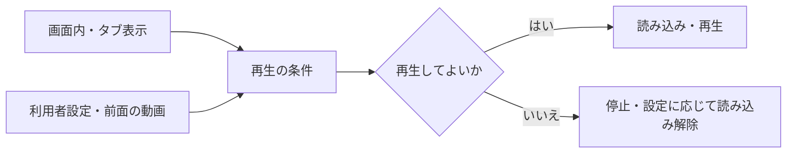

# Web Media Controls

**映像のあるWebページで、見る人の設定と表示状態に合わせて、動画の読み込み・再生・停止を制御します。**

画面外でも再生し続ける。別の動画を見始めても背景映像が動く。動きを減らす設定へ切り替えても止まらない。ブランドサイトの制作で向き合ったこうした挙動を、小さなJavaScriptの部品に整理しました。

Dependency-free lifecycle helpers for muted decorative video, with TypeScript declarations. Works with plain HTML and React.

## 扱う状態

- 画面内に入るまで、動画の `src` を設定しない
- 画面外・非表示タブでは停止する
- 動きを減らす設定とSave-Dataが途中で変わっても対応する
- 利用者が停止したら、表示状態の変化だけで勝手に再開しない
- 前面の動画を再生すると背景を停止し、他の前面動画も停止する
- 破棄時にObserverとイベントを解除し、遅れて完了する `play()` も停止する



## すぐ試す

Node.js 22以降。依存のインストールは不要です。npmレジストリへの公開はしていません。

```sh
git clone https://github.com/YAMADA-Ryosuke-0114/web-media-controls.git
cd web-media-controls
npm test
npm run demo
```

デモは `http://127.0.0.1:4173`。自作のテスト映像だけを使い、実際のブランド映像・顧客素材は含めていません。

```html
<video id="ambient" muted loop playsinline preload="none"></video>
```

```js
import { createMediaController } from './src/index.js';

const controller = createMediaController(
  document.querySelector('#ambient'),
  { src: './sample.mp4' },
);
// 利用者の操作へ接続する
pauseButton.addEventListener('click', () => controller.pause());
resumeButton.addEventListener('click', () => controller.resume());
// 要素を外すときは controller.destroy()
```

Reactでは、`useEffect` 内で生成し、cleanupで `destroy()` を呼びます。

```jsx
useEffect(() => {
  const controller = createMediaController(videoRef.current, { src });
  return () => controller.destroy();
}, [src]);
```

前面の動画を調整する場合は、`bindForegroundPause(controller, foregroundVideos)` が返す解除関数もcleanupで呼んでください。動画一覧は登録時のものなので、追加した要素は登録し直します。

## 適用範囲

無音の装飾動画を自動制御するための部品です。音声付きのメイン動画や、利用者が操作するプレイヤーをそのまま置き換えるものではありません。ブラウザによっては自動再生を拒否されます。

IntersectionObserverがない環境では、動画を読み込まずポスター表示を維持します。Save-Dataは対応するブラウザで有効です。通信量や電池消費の削減率は実測していないため、数値を保証しません。

## 出典と利用条件

自分のブランドサイトにある動画制御の実装から、振る舞いを切り出してAIの支援で整理しました。ブランド固有の映像、CSS、ロゴ、顧客データ、ページ全体のコードは含めていません。来歴と変更点は[PROVENANCE.md](PROVENANCE.md)に記載しています。

公開コードは[MIT](LICENSE)です。実際に使う映像・写真の利用条件は、それぞれ別に確認してください。

## 制作と活動

山田遼祐。Webと映像をつなぎ、表現と使いやすさを両立する制作に取り組んでいます。

- [活動と制作](https://yamada-ryosuke.com/)
- [Web・映像の制作支援](https://aiconication.com/iconication)
- [AIconication](https://aiconication.com/)

お店や会社の世界観をWeb・SNS・映像へつなぐ制作のご相談は、AIconicationからご連絡いただけます。
